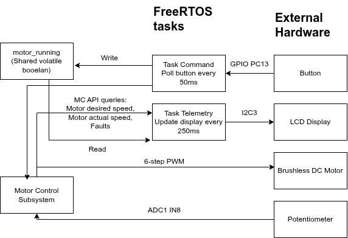

**Project choice**:

In this project I used an STM32 motor control development kit (P-NUCLEO-IHM03) to control a motor with a button to enable and disable, a potentiometer to control its speed and a LCD to show its target an actual speed. It makes sense to use an RTOS for this system because I have multiple different tasks with different rates and priorities. It is also important that strict timings are fulfilled. For example it's important for the button press to stop the motor instantaneously, instead of waiting for the LCD segment code to finish. it is also important for the potentiometer values to be read quickly and for those to be sent to the motor as quickly as possible.

**Architecture diagram**:

**Design decisions**
I separated the application into two main FreeRTOS tasks: TaskCommand and TaskTelemetry.

TaskCommand is responsible for checking the start/stop button and sending commands to the motor-control subsystem. It runs at normal priority and checks the button every 50 ms. I chose to keep button handling in its own task so that it is independent of the LCD update process.

TaskTelemetry reads the motor's target speed, actual speed, and fault status, then updates the LCD. It runs at below-normal priority and updates every 250 ms. Since the LCD does not need to be updated continuously, giving this task a lower priority prevents its relatively slow communication from interfering with more important application operations.

The two tasks share a global variable, motor_running, which tracks whether the motor is intended to be running. TaskCommand updates this variable when the button is pressed, and TaskTelemetry reads it when determining what target speed to display. This avoids needing to pass the motor's running state between tasks through a queue.

The motor-control subsystem is kept separate from the application tasks. The application interacts with it through its API, while the underlying motor-control algorithm handles the actual motor operation. TIM6 periodically triggers MC_RunMotorControlTasks() through a hardware timer interrupt, allowing the motor-control software to execute independently of the FreeRTOS task schedules.

I kept the LCD update and button handling in separate tasks because they have different timing requirements and responsibilities. I also avoided creating a separate task for every individual operation, since that would add unnecessary scheduling overhead and complexity.

**Consequence of RTOS**
One major consequence of introducing an RTOS is that the system now has to manage shared state and concurrent execution. For example, motor_running is accessed by both TaskCommand and TaskTelemetry. This introduces the possibility of inconsistencies if shared data becomes more complicated, so care must be taken when designing communication between tasks.

The RTOS also introduces some scheduling overhead, memory usage for task stacks, and additional complexity compared to a simple superloop implementation. Tasks can be interrupted or delayed by other higher-priority tasks, so their execution timing is no longer determined solely by the order of function calls in the main loop.

In this project, the button is polled every 50 ms, meaning a press may not be detected immediately. However, separating button handling from LCD updates means that the button does not have to wait for the LCD update code to finish before being processed. The motor-control algorithm also continues to be serviced by the TIM6 interrupt independently of these tasks.

Overall, the RTOS makes the application more modular and provides better separation between operations, but it also introduces additional complexity that would need to be considered in a larger system.

**Link to video**:
<video controls src="Motormovertos.MOV" title="MotorMove"></video>
(if video isn't loading, use [link](github.com/Zaraius/motormoveRTOS/Motormovertos.MOV))